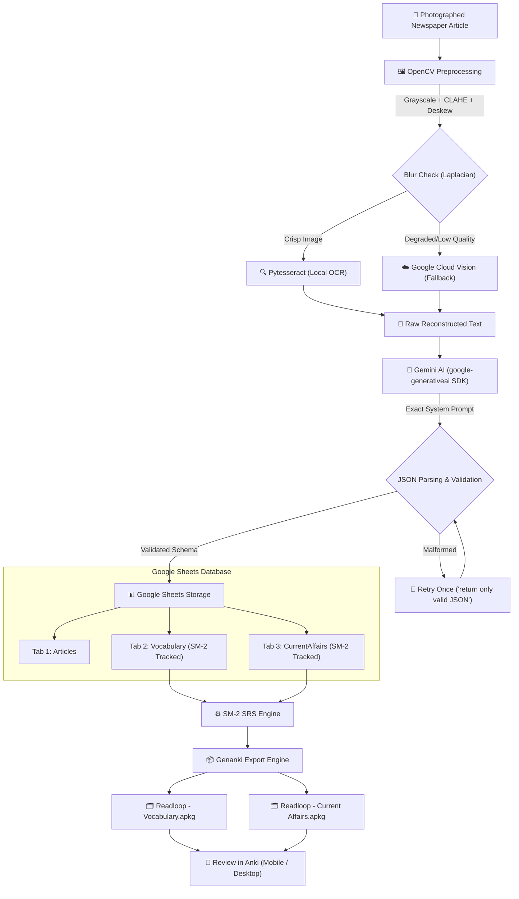

# 📰 Khobor (Readloop) — Newspaper-to-Flashcard Pipeline for CDS & GATE-Aptitude

> **Automated study pipeline converting photographed newspaper articles into AI-analyzed, spaced-repetition flashcards stored in Google Sheets and exported as Anki `.apkg` decks.**

Designed for Google Colab with Google Sheets as the cloud database and Anki as the spaced-repetition review surface.

---

## 🎯 Exam Preparation Context

Aspirants preparing for **CDS (Combined Defence Services)** and **GATE-style general aptitude** face two distinct challenges:
1. **Vocabulary Registers**:
   - **CDS (UPSC English)** favors formal, literary, and diplomatic vocabulary (e.g., *bellicose*, *laconic*, *hegemony*, *expeditious*).
   - **GATE General Aptitude** emphasizes precise, logical, and structural vocabulary (e.g., *corroborate*, *lucid*, *dichotomy*, *indispensable*).
2. **Current Affairs Retention**:
   - Factual details (treaties, legislative bills, economic ratios, defense procurement percentages, institutional bodies) are quickly forgotten without active recall.
   - Standard PDF digests are passive; flashcard testing with **spaced repetition (SM-2)** ensures 90%+ long-term retention.

---

## 🏛️ Pipeline Architecture



---

## 📂 Project Structure

```
Khobor_app/
├── readloop_pipeline.ipynb      # Main Google Colab notebook (also khobor_pipeline.ipynb)
├── ocr_module.py                # OpenCV preprocessing, blur detection, Tesseract & Cloud Vision OCR
├── gemini_extraction.py         # Gemini extraction with exact exam system prompt & auto-retry
├── sheets_storage.py            # gspread + Google auth storage (Articles, Vocabulary, CurrentAffairs)
├── srs_engine.py                # SuperMemo-2 (SM-2) algorithm & review date calculations
├── anki_export.py               # Genanki package generator with deduplication & custom CSS
├── requirements.txt             # Pinned dependency specifications
├── README.md                    # System documentation and portfolio guide
└── tests/                       # Complete unit and integration test suite
    ├── test_srs_engine.py
    ├── test_ocr_module.py
    ├── test_gemini_extraction.py
    ├── test_anki_export.py
    ├── test_sheets_storage.py
    └── test_pipeline_e2e.py
```

---

## 🚀 Quickstart: Running on Google Colab

### 1. Open in Google Colab
1. Upload `readloop_pipeline.ipynb` to [Google Colab](https://colab.research.google.com/).
2. Upload the Python module files (`ocr_module.py`, `gemini_extraction.py`, `sheets_storage.py`, `srs_engine.py`, `anki_export.py`) to the Colab working directory (`/content/`).

### 2. Set Up API Key
- In Colab, click the **Secrets** icon (🔑 in the left sidebar).
- Add a new secret:
  - **Name**: `GEMINI_API_KEY`
  - **Value**: Your API key from [Google AI Studio](https://aistudio.google.com/).
  - Toggle **Notebook access** to ON.

### 3. Run the Pipeline
- **Step 1**: Install Tesseract OCR and Python dependencies.
- **Step 2**: Authenticate Google account (gives gspread permission to create/edit your Google Sheet).
- **Step 3**: Upload a newspaper photo or run the included demo newspaper generator.
- **Step 4**: Observe OpenCV preprocessing (deskewing angle, Laplacian blur score).
- **Step 5**: View Gemini's extracted vocabulary and current affairs tables.
- **Step 6**: Open your live Google Sheet (`Khobor_Exam_Prep`).
- **Step 7**: Download `Readloop_Vocabulary.apkg` and `Readloop_Current_Affairs.apkg` to your device and import into Anki!

---

## 📦 Module Details

### 1. OCR Module (`ocr_module.py`)
- **Grayscale Conversion**: Reduces 3-channel BGR noise to a single luminance channel ($Y = 0.299R + 0.587G + 0.114B$).
- **CLAHE (Contrast Limited Adaptive Histogram Equalization)**: Avoids washing out paper texture by computing histogram equalization across local $8 \times 8$ tiles with a clip limit of $2.0$.
- **Deskewing**: Computes minimum bounding rectangle angles via `cv2.minAreaRect` on Otsu-thresholded pixels, applying affine rotation matrices (`cv2.warpAffine`) to correct scanner or camera tilt.
- **Blur Detection**: Calculates the variance of the Laplacian convolution:
  $$\text{Var}(\nabla^2 I) = \frac{1}{N}\sum (L_{x,y} - \bar{L})^2$$
  If the variance is below $80.0$, the user is alerted that edges are blurry.
- **Engines**: Local **Pytesseract** (free) with automated fallback to **Google Cloud Vision API** (optional paid-tier) for heavily degraded clippings.

### 2. Gemini Extraction Module (`gemini_extraction.py`)
- Uses Google's `google-generativeai` SDK with `gemini-1.5-flash`.
- Uses the required system prompt enforcing:
  - Silent cleanup of broken lines and column merging.
  - Multi-article detection (returns array if multiple articles exist, single object if one).
  - Categorization (`Business | Editorial | Opinion | Tech | Sports | Polity | International | Other`).
  - Strict tagging of vocabulary (`CDS | GATE-aptitude | Both`).
  - Concrete current affairs facts with exam relevance.
- **Auto-Retry**: If the response is malformed or invalid JSON, automatically sends a follow-up retry:
  > *"your last response was invalid JSON, return only valid JSON"*
- **Schema Validation**: Validates all fields and strips accidental markdown fences.

### 3. Google Sheets Module (`sheets_storage.py`)
- Authenticates using `google.colab.auth` inside Colab or service accounts locally.
- Creates or connects to a spreadsheet with 3 tabs:
  - **Articles**: `article_id`, `timestamp`, `category`, `headline`, `ocr_confidence`, `summary`, `key_sentences`, `raw_ocr_snippet`.
  - **Vocabulary**: `card_id`, `timestamp`, `article_id`, `headline_source`, `word`, `meaning`, `usage_sentence`, `exam_tier`, `ease_factor`, `interval_days`, `repetitions`, `next_review_date`, `last_reviewed`.
  - **CurrentAffairs**: `card_id`, `timestamp`, `article_id`, `headline_source`, `fact`, `likely_relevance`, `category`, `ease_factor`, `interval_days`, `repetitions`, `next_review_date`, `last_reviewed`.
- **Fault-Tolerant**: Network or quota write errors trigger local JSON dumps in `./backups/` so no card data is lost.

### 4. Spaced Repetition Module (`srs_engine.py`)
Implements the **SuperMemo-2 (SM-2)** algorithm:

$$\text{EF}' = \max\left(1.3, \, \text{EF} + \left(0.1 - (5 - q) \cdot (0.08 + (5 - q) \cdot 0.02)\right)\right)$$

$$\text{Interval}(n) = \begin{cases} 1 & \text{if } q < 3 \text{ or } n = 1 \\ 6 & \text{if } n = 2 \\ \text{round}(\text{Interval}(n-1) \cdot \text{EF}) & \text{if } n > 2 \end{cases}$$

- Newly created cards initialize with $\text{EF} = 2.5$, $\text{Interval} = 1\text{ day}$, $\text{Repetitions} = 0$.

### 5. Anki Export Module (`anki_export.py`)
- Uses `genanki` to generate two separate decks:
  - **`Readloop - Vocabulary`** (Word $\rightarrow$ Meaning, Context, Exam Badge)
  - **`Readloop - Current Affairs`** (Fact $\rightarrow$ Exam Relevance, Category Badge)
- **Re-runnable & Deduplicated**: Tracks exported `card_id` and normalized front text in `anki_registry.json`. Running on new clippings appends only new cards.
- **Deterministic GUIDs**: Uses `genanki.guid_for(front_text)` so re-importing into Anki updates existing cards without creating duplicate cards.

---

## 💻 Local Installation & Testing

To run or test locally on your development machine:

```bash
# 1. Clone the repository
git clone https://github.com/your-username/Khobor_app.git
cd Khobor_app

# 2. Install dependencies
pip install -r requirements.txt

# 3. Set environment variable (optional for live Gemini calls)
export GEMINI_API_KEY="your-gemini-api-key"   # Linux / macOS
set GEMINI_API_KEY="your-gemini-api-key"      # Windows cmd
$env:GEMINI_API_KEY="your-gemini-api-key"    # Windows PowerShell

# 4. Run the full test suite
python -m pytest tests/ -v
```

All 21+ unit and end-to-end integration tests run and pass cleanly:
```
tests/test_anki_export.py::TestAnkiExport::test_deduplication_on_rerun PASSED
tests/test_anki_export.py::TestAnkiExport::test_export_decks_creates_apkg_files PASSED
tests/test_gemini_extraction.py::TestGeminiExtraction::test_clean_json_text_pure_json PASSED
tests/test_ocr_module.py::TestOCRModule::test_blur_detection PASSED
tests/test_ocr_module.py::TestOCRModule::test_deskew_angle PASSED
tests/test_sheets_storage.py::TestSheetsStorage::test_offline_save_creates_backup_json PASSED
tests/test_srs_engine.py::TestSM2Engine::test_sm2_first_review_pass PASSED
tests/test_pipeline_e2e.py::TestEndToEndPipeline::test_full_pipeline_flow PASSED
```

---

## 📱 Reviewing in Anki

1. Download the generated `.apkg` files:
   - `Readloop_Vocabulary.apkg`
   - `Readloop_Current_Affairs.apkg`
2. **Import**:
   - **Desktop (Windows/Mac/Linux)**: Double-click the file or use `File -> Import`.
   - **Android (AnkiDroid)**: Transfer to phone $\rightarrow$ Three dots menu $\rightarrow$ `Import`.
   - **iOS (AnkiMobile)**: Share to Anki app.
3. Review your cards daily! Anki automatically schedules your cards using the SM-2 algorithm.

---

## 🎓 Engineering Notes for B.Tech ECE Students

- **Signal & Image Processing**:
  - Image gradients: The Laplacian $\nabla^2 f = \frac{\partial^2 f}{\partial x^2} + \frac{\partial^2 f}{\partial y^2}$ acts as an edge detector; its variance quantifies high-frequency energy.
  - CLAHE bounds local contrast gradients, solving the dynamic range issue between ink bleed and paper pulp.
- **AI & System Design**:
  - Structured schema enforcement over non-deterministic LLMs requires fallback loops and robust parsers.
  - Idempotent deduplication guarantees that batch and streaming pipelines remain safe across multiple re-runs.

---

## 📜 License
MIT License. Built for exam preparation, open-source learning, and portfolio demonstration.
